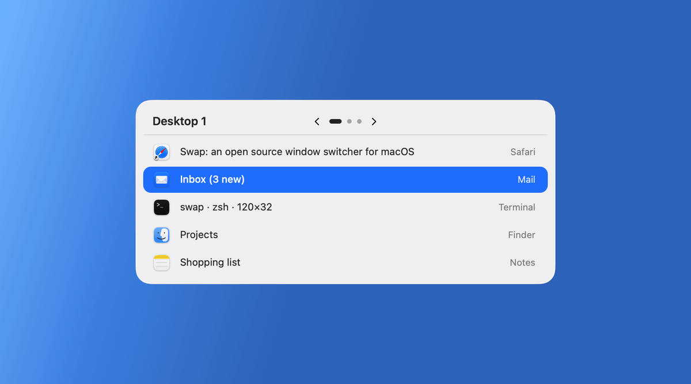
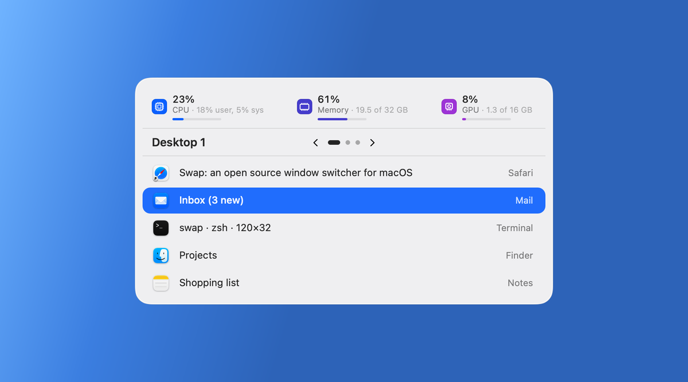
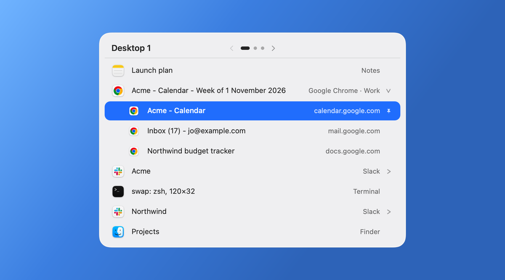
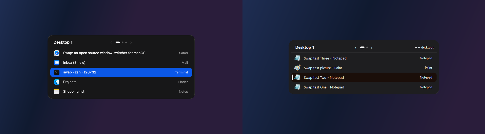

<picture>
  <source media="(prefers-color-scheme: dark)" srcset="screenshots/swap-wordmark-dark.svg">
  
</picture>

The fastest way to get to anything on your Mac without leaving the keyboard. Hold **Option**, tap **Tab**,
and you are looking at where you were working: every window in last-used order, the tabs and chats inside
them, and a search for the rest. Let go and you are there. Open source, for macOS (and a plainer Windows
version).

<picture>
  <source media="(prefers-color-scheme: dark)" srcset="screenshots/swap-hero-dark.gif">
  
</picture>

Only Accessibility is required: Swap never asks for Screen Recording. Tabs from a browser and file search
each bring one more macOS question the first time you use them ([details](#permissions)). Download the DMG from
[Releases](https://github.com/DavidMolina001/swap/releases) (not notarised yet, so macOS asks for Open Anyway once), or
build it yourself, which takes about a minute and needs no Xcode. MIT licence.
Not affiliated with AltTab; written from scratch.

## You need

- macOS 13 Ventura or later, Intel or Apple silicon.
- The Xcode Command Line Tools. If you have never built anything, run `xcode-select --install` in
  Terminal once (a few minutes, no Xcode needed).
- The source: `git clone https://github.com/DavidMolina001/swap`, or Code > Download ZIP on GitHub and
  unzip it.

## Install (Mac)

1. In Terminal, in the `swap` folder, run `./src/build.sh`. About a minute. It makes `build/Swap.app`
   (Intel + Apple silicon, ad-hoc signed, hardened runtime) and does not install or start anything.
2. Drag `build/Swap.app` to Applications and double-click it. Because you built it yourself, macOS shows no
   "can't verify" warning. If you got a copy from someone else and macOS refuses to open it, go to
   System Settings > Privacy & Security and click Open Anyway.
3. Swap has no window. It shows a Dock icon and the two overlapping rectangles in the menu bar; you can switch the
   Dock icon off in Settings > Appearance > Swap itself.
4. macOS asks to let Swap control the computer with accessibility features. Click Open System Settings,
   switch **Swap** on under Privacy & Security > Accessibility, and confirm with your password or Touch ID.
   Swap needs this to see window titles, read your keystrokes and raise windows. It checks every second
   and starts working as soon as you allow it. The menu bar item "Accessibility needed. Click to open
   settings" takes you back to that page if you closed it.
5. Once Accessibility is on, Swap shows a one-time "Swap is ready" note with the keys and switches
   **Start at login** on (it needs to run to learn the windows on your other desktops). macOS shows a
   "Background Items Added" notification; that is normal. Turn it off in Settings… > General if you prefer.

Press Option + Tab. The list appears with your windows, most recent first. For the first ten opens a quiet
line at the foot of the list says what the keys do on the selected row.

## Use (Mac)

| Keys | Does |
|---|---|
| Option + Tab | Open the list, step to the next window |
| Option + Shift + Tab | Step back |
| Up / Down arrows | Move up and down the list |
| Two-finger swipe, or Left / Right arrows | Show the windows on the next or previous desktop |
| 1 to 9 | Jump to that row |
| Return | Switch to the selected window. With **Show tabs and chats inside apps** on (Settings > Inside apps), Return on a browser, Slack or WhatsApp row lists what is inside it, and Return on one of those opens it |
| Shift + Return | Fold an expanded row back up |
| W | Close the selected window or tab; the list stays open |
| Q | Quit the selected row's app; the list stays open |
| P | Pin or unpin the selected tab or chat: pinned ones are listed first under their row |
| N, F, T, K, G, L, O, R | That app's own Command + letter, aimed at the selected row: N for new, F on a Slack channel searches it, K opens Slack's quick switcher |
| / or Space | Jump to search |
| Release Option | Switch to the selected window, tab or chat |
| Esc | Cancel |
| Click a row | Switch to it |

Any other letter does nothing and the list says so: the keys above are an allowlist, so a stray key never
reaches an app. A key a row has no use for says so too: W on a Slack workspace row, for example, because all
its workspaces share one window.

The list is in last-used order across all apps, so the window you were just in is always second:
a quick Option + Tab (released straight away) flips to it without showing the list, even when it is on
another desktop. Only the letters in the table reach an app, and only as its Command shortcut; nothing you
type while the list is open lands in the window behind it.
Minimised windows carry a "Minimised" tag and are restored when picked. Each row shows the app name on
the right. The list follows the system appearance (light or dark) and wears a colour theme: Full Stripe by
default, or System, which follows the system accent colour, with black text on the selected row when the accent
colour is too light for white. It honours Increase Contrast, Reduce
Motion and Reduce Transparency. VoiceOver support is written but has not been tried with VoiceOver running.

**Desktops.** The list opens on the desktop you're on. Swipe left with two fingers (the same direction as
the system's three-finger swipe) to see the next desktop's windows, right to go back; the dots at the top
show where you are. Pick a window on another desktop and macOS moves you there. Full-screen apps get
their own page.

**Slow apps.** An app that stops answering (the spinning beach ball) never holds up the keyboard or the
switcher: its windows are listed under the app name and the rest of the list opens as usual.

## Search (Mac)

Press **/** or **Space** with the list open, or Up on the first row then Return, and start typing. Search
finds open windows, apps and files, using the Spotlight index your Mac already has. **f then Space** limits it
to files. Return opens the selected result and Command + Return shows a file in Finder. Esc leaves.

The first time search looks for files, macOS asks for your Desktop, Documents and Downloads folders, one
prompt each. Say no and those folders are left out; everything else still works. You can change the answer in
System Settings > Privacy & Security > Files & Folders. You can switch the search row off in Settings > List.

## Menu and Settings (Mac)

The menu bar icon has **Show window list** (opens the list with the mouse; it stays until you pick or press
Esc), **Timer** (5, 15, 25, 45 minutes, Custom, Stop; see "At a glance"), **Settings…**, **Personalisation**
(quick copies of the look settings), **About Swap** and **Quit Swap**. While Accessibility is missing, a line
at the top takes you to the right System Settings pane.

Swap's Dock icon opens the same menu when you click it, and offers the same items on a right-click. The last row
of the list on your desktop is Swap itself ("Swap", "Menu" on the right): pick it (Return, let go of Option, a
click or its number) and the list closes and this menu opens. A quick Option + Tab never lands on it, and W, Q and
P do nothing on it. Both can be switched off in Settings > Appearance > Swap itself.

Settings has seven panes:

| Pane | Settings |
|---|---|
| General | Shortcut (Option + Tab, Command + Tab, Control + Tab); which screen the list opens on; start at login; permissions |
| Keys | Quick flip; number keys; letter keys; keep the list open until you choose; every key listed |
| List | What is listed: minimised windows, windows of hidden apps, windows with no title, the search row; apps to leave out |
| Inside apps | **Show tabs and chats inside apps** (on by default); order of tabs and chats; Slack: one row per workspace, which workspaces show, Clear saved chats; WhatsApp: show chats (off until you switch it on), show Archived; pins |
| Appearance | A preview that plays a setting once when you point at it or change it, then rests on your own list. Theme (Full Stripe, Soft Rainbow, Dusk, Night Arcade, Sorbet, Sea Glass, Dusty Seventies, Blossom, or System for the Mac's accent colour: the selected row, unread dots and Glance bar tiles; Full Stripe also puts a thin stripe band along the top and stripes at the end of the selected row); appearance (match system, light, dark); list width (same every time, or fit the longest name); app name on the right; animations (off by default, for the fade on opening; a desktop swipe always follows your fingers unless Reduce Motion is on); one page per desktop or all desktops in one list; page dots (one per desktop, or compact: 5 at most); hide desktops with no windows; Swap itself: show in the Dock, show Swap at the bottom of the list (both on by default) |
| Glance bar | On or off; density (Compact, Regular, Detailed); Quota widget text; widgets and their order; timer presets and alert |
| About | Version, links, releases |

Command + Tab replaces the Mac app switcher while Swap runs. Settings are stored in the user defaults of
`com.davidmolina.swap` (see [Privacy](#privacy)).

## At a glance (Mac)

Swap can show a strip of small readings above the list: the **glance bar**. It is **on** by default and can be switched
off in Settings > Glance bar > Show glance bar. Readings are taken only while the list is open: nothing runs
in the background, nothing is stored, nothing leaves the Mac. Up to six widgets fit; pick them and their order
in Settings > Glance bar.

<picture>
  <source media="(prefers-color-scheme: dark)" srcset="screenshots/swap-glance-dark.gif">
  
</picture>

| Widget | What the glance bar reads | Asks macOS for permission? |
|---|---|---|
| CPU | Whole-Mac processor use, from the kernel's per-core counters | No |
| Memory | Used memory and the system's memory pressure level | No |
| GPU | Graphics use as reported by the driver; "n/a" when the Mac reports nothing | No |
| Quota | The figures the Quota app writes to a small file after each refresh; hidden when Quota is not installed | No |
| Network | Bytes in and out on the Mac's network interfaces, whole Mac only | No |
| Downloads | Files still downloading in your Downloads folder (Safari, Chrome, Firefox partial files). Off by default | Yes, the Downloads folder prompt, the first time you add the widget |
| Timer | Your own countdown (menu bar > Timer). At zero: alert sound, the menu bar icon flashes, "Timer done" for a minute | Only if you tick "Also send a notification" |

Density: Compact (28 pt, icon and value), Regular (36 pt, adds a label), Detailed (56 pt, adds a level bar
and a second line, below).

<picture>
  <source media="(prefers-color-scheme: dark)" srcset="screenshots/swap-glance-detailed-dark.png">
  
</picture>
 A widget with nothing to show (no download running, no timer) hides and the others
spread out; the bar keeps its height so the list never jumps. Warnings recolour a tile and its value orange
(CPU above 85% sustained, Memory under pressure, Quota above 80%), red at Quota's limit. Nothing in the
bar is clickable.

## Inside apps: tabs and chats (Mac)

<picture>
  <source media="(prefers-color-scheme: dark)" srcset="screenshots/swap-inside-dark.png">
  
</picture>

On by default (**Show tabs and chats inside apps**, at the top of Settings > Inside apps): a browser window or a
Slack workspace gets a small chevron on the right. WhatsApp's chats are off until you switch on **Show WhatsApp
chats** in the same pane, because WhatsApp's terms are the broadest. Return opens it in place,
indented, like a folder:

- **Chrome, Edge, Brave, Safari:** the window's tabs, with the site on the right and the current tab
  marked. Chrome rows also show the profile ("Google Chrome · Work"), so windows from two profiles stay apart.
- **Slack:** one row per workspace, each placed in the list by when you last used it, so a workspace you
  never open sinks to the bottom. Return on one lists the 6 chats you used last, plus pinned and unread ones.
  No sign-in and no Slack API: Swap reads what Slack shows on your Mac and opens chats with Slack's own links.
  Slack's terms have no clause against this, but check your employer's software policy before using it with a
  work Slack. While this setting is on, Slack keeps its accessibility tree built, which can slow it slightly.

Up and Down move through the children like any other row. Return on a tab or chat, or releasing Option on
it, brings the window forward and switches to it. Shift + Return folds the row back up. Esc still cancels
everything. Quick flips are untouched: Option + Tab, release, still lands on the window you used before.

**Order of tabs and chats** (Settings > Inside apps): as the app shows them, or most recent first.
Most recent first puts the tab you are on at the top and the one you used before it second, so Return,
Return flips between two tabs the way Option + Tab flips between two windows. **Pins** come before either:
press P on a tab or chat while the list is open and it stays first under its row, with a small pin, until you
press P on it again. Pins are per browser and per Slack workspace; Settings > Inside apps lists them and can
clear them.

**WhatsApp** works the same way: its recent chats, plus Archived if you switch that on. It reads your chat
list on this Mac and never sends anything. WhatsApp does not endorse this and its terms are broad, so it stays
off unless you switch on the setting above. Finder always has a row, even with no windows open.

### Permissions

- **Accessibility** (required): lists windows, reads the shortcut, and reads tabs, Slack and WhatsApp.
- **Automation** (browsers, optional): for details Accessibility cannot reach, such as site names and windows
  on other desktops, Swap asks the browser directly. macOS asks once per browser, the first time it is needed:
  "Swap wants to control Google Chrome". Say no and those details are missing; nothing else changes.
- **Desktop, Documents and Downloads** (file search, optional): see [Search](#search-mac).
- **Downloads** also for the Downloads widget, and **Notifications** if you tick "Also send a notification" on
  the timer.

Settings > General lists these with a link to each System Settings page. Slack and WhatsApp need nothing extra.

## Privacy

**Nothing leaves the Mac.** Swap has no network code, no sign-in, no analytics and no update check. No message
text is stored.

Swap reads, on your Mac and through Accessibility: window and tab titles, tab addresses, chat names, unread
marks, and the text of Slack's sidebar. WhatsApp has no separate unread mark, so to find which chat is unread
Swap may read a row's message preview while you press Return on WhatsApp and its Dock badge says something is
unread. The preview passes through memory, is searched for the word "unread" and is dropped: never stored,
logged or shown. The dot on the WhatsApp row itself comes from the Dock badge, not from any preview.

What is stored, all in one plain preferences file,
`~/Library/Preferences/com.davidmolina.swap.plist`, which any program you run can read and which your backups
include:

| Stored | Key | When |
|---|---|---|
| Slack workspace names and ids | `slackTeams` | Only while Show tabs and chats inside apps is on |
| Up to 50 Slack chats per workspace: the channel or person's name, its id, its kind, when you last used it | `slackRecents` | Same |
| When you last used each Slack workspace | `slackWorkspaceUse` | Same |
| Pins: Slack chat ids, browser page addresses or tab titles, WhatsApp chat names | `pins` | When you pin something |
| Slack workspaces you hid; apps you left out | `slackHidden`, `hiddenApps` | When you choose them |
| Your settings and a few "already shown" flags | The rest, listed under [For developers](#for-developers) | Always |

How to clear it:

- **Slack:** Settings > Inside apps > **Clear saved chats** removes the Slack names, ids, times and Slack pins.
  Switching off Show tabs and chats inside apps removes the same things but keeps your pins.
- **Pins:** Settings > Inside apps > Pinned.
- **Everything:** quit Swap, then run `defaults delete com.davidmolina.swap`. Moving Swap to the Bin does not do
  this: the file stays behind until you run that command.

## What it does not do yet (0.8)

- **Search** finds windows, apps and files, not yet the tabs and chats inside apps.
- A **Calendar widget** and a shared menu bar item with Quota come in a later version.
- Widgets do not open anything when clicked; no graphs or history lines in the bar.
- **Windows on other desktops** are listed once Swap has seen them: when they open, when you use
  them, or when you visit their desktop while Swap runs (it starts at login). macOS doesn't offer a public
  way to list them, so Swap uses private window-server calls; a future macOS could change that.
- **No thumbnails.** Icon and title only. Live previews would need Screen Recording.
- Windows you haven't touched since Swap started are ordered by how they are stacked on screen.
- No custom shortcut recorder yet (three fixed choices).

## Update (Mac)

1. Menu bar icon > Quit Swap.
2. In the `swap` folder: `git pull`, then `./src/build.sh`.
3. Drag the new `build/Swap.app` to Applications, replacing the old one, and open it.
4. Each build has a new ad-hoc signature, so macOS treats it as a new app. If Option + Tab does nothing,
   open System Settings > Privacy & Security > Accessibility and switch Swap off and on again (or remove it
   with the minus button and add it back).

To keep the permission across rebuilds, sign with your own certificate: in Keychain Access choose
Keychain Access > Certificate Assistant > Create a Certificate, name it (for example "Swap Signing"), type
Code Signing, then build with `SWAP_SIGN="Swap Signing" ./src/build.sh`.

## Uninstall (Mac)

1. Menu bar icon > Settings… > General: switch **Start Swap at login** off. Then **Quit Swap**.
2. Move /Applications/Swap.app to the Bin.
3. System Settings > Privacy & Security > Accessibility: select Swap and press the minus button.
4. Run `defaults delete com.davidmolina.swap` to remove the settings, including any saved chat names and pins
   (see [Privacy](#privacy)). Without this they stay on the Mac.

## Windows version

`windows/` has the same switcher for Windows 10 and 11 (64-bit): hold **Alt**, tap **Tab**, a list of
windows in last-used order, one page per virtual desktop (Left / Right arrows; no swiping), release Alt
to jump, including to a window on another desktop. It replaces the built-in Alt+Tab while it runs; Quit in
its tray icon brings the built-in one back. Nothing to install: it builds with the C# compiler that ships
with Windows. It is a companion to the Mac app: same look (dark or light, following Windows, with your
accent colour) and the same core keys, but windows only: no tabs, chats, pins or search, no Settings window
and no glance bar.

| Keys | Does |
|---|---|
| Alt + Tab, Alt + Shift + Tab | Open the switcher, step forward or back |
| Up / Down, Left / Right | Move through the rows; show the next or previous desktop |
| 1 to 9 | Jump to that row |
| W, or Delete | Close the selected window (the list stays open) |
| Q | Quit the selected window's app: closes all its windows, politely, so it can ask about unsaved work |
| Release Alt, or Return | Switch to the selected window |
| Esc | Cancel |

Mac on the left, Windows on the right.

1. Get the source: Code > Download ZIP on GitHub and extract it (or `git clone`).
2. Open PowerShell and go to the `windows` folder, for example
   `cd "$HOME\Downloads\swap-main\windows"`.
3. Build: `powershell -ExecutionPolicy Bypass -File build.ps1`.
4. Install: `powershell -ExecutionPolicy Bypass -File install.ps1`. It copies Swap.exe to
   `%LOCALAPPDATA%\Programs\Swap`, starts it at login and starts it now. Look for the tray icon.

`install.ps1 -Admin` (from an admin PowerShell) runs Swap elevated through a logon task, so it can also
switch to windows of apps that run as administrator. Without it, those windows are listed but can't be
brought forward.

**Update:** build again, run install.ps1 again (it stops the running copy and replaces it).

**Uninstall:** Quit from the tray icon, delete `%LOCALAPPDATA%\Programs\Swap`, then remove the start-up
entry: the `Swap` value under `HKCU\Software\Microsoft\Windows\CurrentVersion\Run`, or the scheduled task
named `Swap` if you installed with `-Admin` (Task Scheduler, or `Unregister-ScheduledTask -TaskName Swap`).

## Bugs and ideas

Open an issue on GitHub. Say your macOS or Windows version and, on a Mac, what Settings > General shows
for Accessibility.

## For developers

Mac source, `src/`:

- `main.swift`: start-up and the command line flags. `AppDelegate.swift`: the menu, the Dock icon (`SwapMenu` opens
  the menu from the Dock and from Swap's own row) and the permission check.
- `Controller.swift`: the keyboard tap (on its own thread, so a slow app never holds up typing), the session, the
  rows on show.
- `Windows.swift`: lists windows in last-used order (focus tracking), reads the list on a background
  queue, and brings one to the front.
- `Panel.swift`: the floating list, its header, page dots and rows, the key hint, what VoiceOver hears.
- `SearchRow.swift`, `SearchSession.swift`, `SearchApps.swift`, `SearchFiles.swift`: the search row and its results.
- `Settings.swift`: the user defaults. `SettingsWindow.swift`, `SettingsPanes.swift`, `SettingsPreview.swift`: the
  Settings window. `ProviderSettings.swift`: what each app adds to Settings > Inside apps.
  Keys: `shortcut` (optionTab | commandTab | controlTab), `quickFlip`, `numberKeys`, `actionKeys`, `drillIn`, `childOrder` (natural | recent),
  `slackWorkspaces`, `slackHidden` (workspace names), `whatsappChats` (default off), `whatsappArchive`, `pins` (workspace or bundle id: child ids), `searchRow` (default on), `keepOpen`, `showOnScreen` (active | mouse),
  `desktops` (pages | flat), `hideEmptyDesktops`, `pageDots` (all | compact), `panelWidth` (fixed | fit), `showMinimised`, `showHidden`,
  `showAppName`, `appearance` (system | light | dark), `theme` (fullStripe | softRainbow | dusk | nightArcade | sorbet | seaGlass |
  dustySeventies | blossom | system; default fullStripe), `hiddenApps` (bundle ids), `hideUntitled`, `animations`,
  `glanceBar`, `glanceDensity` (compact | regular | detailed), `glanceWidgets` (ordered: cpu memory gpu quota
  network downloads timer), `quotaCell` (tightest | pill), `timerAlert`, `timerNotify`, `showInDock` (default on),
  `showSelfInList` (Swap's own row at the foot of the list, default on).
  Saved by the providers: `slackTeams`, `slackRecents`, `slackWorkspaceUse`.
  "Already shown" flags: `readyShown`, `glanceInvited`, `glanceDownloadsAllowed`, `searchFoldersAsked`, `hintShows`, `keyHintShows`.
- `GlanceModel.swift`, `GlanceSamplers.swift`, `GlanceBarView.swift`: the glance bar. Readings come from
  `host_processor_info`, `host_statistics64`, IOKit's IOAccelerator statistics, `getifaddrs` and the
  Downloads folder; the Quota widget reads `~/Library/Application Support/Quota/glance.json`
  (`{"pill":"…","tightest":{"text":"42% 5h","fraction":0.42,"level":"normal"},"detail":"…","updated":<unix>}`),
  ignored when older than 15 minutes.
- `Tokens.swift`: generated from `design/tokens.json` by `design/gen-tokens.py` (which also writes
  `windows/Tokens.cs`). Every colour, size and font of the panel lives in that JSON; edit it, re-run the script.
- `Spaces.swift`: desktops, which desktop a window is on, bringing a window on another desktop forward.
- `Children.swift`: the `AppProvider` protocol, its registry and the row-expansion model. The core has no
  app-specific code: each app is a provider. `BrowserTabs.swift`: tabs through the Accessibility tab strip, Apple
  Events when the strip is out of reach, the Chrome profile. `SlackSource.swift`, `SlackRows.swift`,
  `SlackRecents.swift`: workspaces from File > Workspace, team and open chat from the window address, recent chats.
  `WhatsAppSource.swift`, `FinderProvider.swift`. `Health.swift`: the read-only check each provider answers (`--health <file>`).
- `build.sh`, `Info.plist`, `Icon/make-icon.swift`, `Swap.icns`: build and icon. `SWAP_SIGN="<certificate>"`
  signs with a stable identity instead of ad-hoc. The app is signed with the hardened runtime.
- `SelfTest.swift`, `TestWindow/SwapTestWindow.swift`, `selftest.sh`: the live test. It builds a test copy,
  opens three TextEdit windows and one Preview window, and drives Swap with real keystrokes and swipes for
  about 2 minutes, including a deliberately frozen helper window. Keep your hands off the keyboard while it
  runs; read the script first. The process that runs it needs Accessibility.
- `Hook.swift`: QA driver (`--hook <dir>`) and fixture scenes, used by the test kit, not needed to run Swap.
- Flags: `./build/Swap.app/Contents/MacOS/Swap --snapshot out.png` draws the panel with sample windows to a
  PNG without showing anything on screen (`SWAP_APPEARANCE=dark` or `light` forces the look);
  `--enable-login-item` switches Start at login on without the menu, for installers; `--prime-permissions` asks
  every browser permission in one sitting; `--selftest <log>` runs the live checks (QA build only).

Windows source, `windows/`: `Swap.cs` (the app; C# 5, so the compiler that ships with Windows builds it),
`Tokens.cs` (generated with the Mac tokens; sizes that share a name with a colour get a `Size` suffix),
`SelfTest.cs` + `selftest.ps1` (live test with Notepad and Paint windows plus one on Desktop 2, number keys,
W on a spare document, Q on Paint, about 2.5 minutes, hands off; needs an admin PowerShell because it
registers a scheduled task at the highest run level), `build.ps1`, `install.ps1`.
